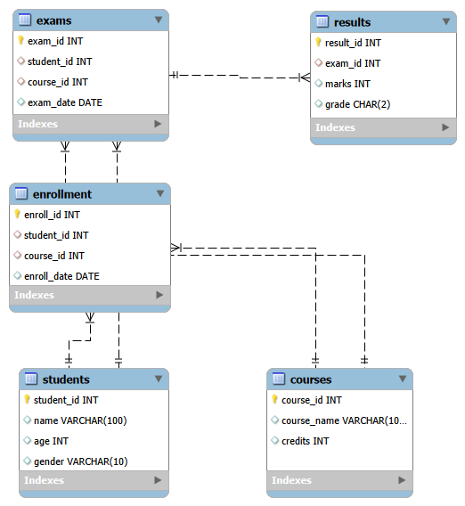

# Student Course-Enrollment System | SQL Project

## 1. Project Overview

The **Student Course Enrollment System** is a database project developed using MySQL to manage student information, course details, enrollments, examinations, and results.

The project demonstrates relational database design and the use of SQL queries to retrieve, analyze, and summarize data across multiple related tables.

## 2. Project Objectives

- Design a relational database for managing student and course information.
- Establish relationships between tables using primary keys and foreign keys.
- Store student enrollment, examination, and result information.
- Retrieve information from multiple tables using SQL joins.
- Analyze enrollment counts and examination marks using aggregate functions.
- Apply conditional logic and subqueries to solve practical data retrieval problems.

## 3. Tools and Technologies

- **Database:** MySQL
- **Database design:** MySQL Workbench, if applicable
- **Query language:** SQL
- **Version control:** Git and GitHub

## 4. Database Schema

The database is named `student_project` and contains five tables.

| Table | Description |
|---|---|
| `students` | Stores student IDs, names, ages, and genders. |
| `courses` | Stores course IDs, course names, and credits. |
| `enrollment` | Stores student enrollment details and enrollment dates. |
| `exams` | Stores examination details, including student, course, and exam date. |
| `results` | Stores examination marks and grades. |

## 5. Entity-Relationship Diagram

The ER diagram illustrates the relationships between the five tables.



### Key Relationships

- Students to Enrollment: One-to-Many
- Courses to Enrollment: One-to-Many
- Students to Exams: One-to-Many
- Courses to Exams: One-to-Many
- Exams to Results: One-to-One, enforced by a unique `exam_id` in the results table

## 6. SQL Concepts Implemented

The project demonstrates the following SQL concepts:

- Database and table creation
- Primary keys and foreign keys
- Unique constraints
- INSERT and SELECT statements
- INNER JOIN and LEFT JOIN
- WHERE and filtering conditions
- GROUP BY and aggregate functions
- Subqueries
- CASE statements
- Date functions using MONTH()
- ORDER BY and LIMIT

## 7. SQL Queries and Analysis

The project contains 13 SQL queries covering the following tasks.

### Basic Data Retrieval
1. List all students.
2. Display all courses.

### Enrollment Analysis
3. Find students enrolled in Database Systems.
4. Count the number of students enrolled in each course.
5. Identify students who are not enrolled in any course.
6. Find the student with the highest number of enrollments.

### Examination and Result Analysis
7. Display examination marks with student and course details.
8. Identify the highest-scoring student.
9. Find courses with no examinations recorded.
10. Calculate average marks for each course.
11. Retrieve students who received Grade A.
12. List examinations conducted in February.
13. Assign grades automatically based on marks using a CASE statement.

The complete SQL scripts are available in `student_project.sql` and `queries.sql`.

## 8. Project Structure

```text
Student-Course-Enrollment-System/
│
├── student_project.sql
├── queries.sql
├── README.md
├── ER_Diagram.png
├── student_project.mwb
│
└── screenshots/
    ├── tables.png
    ├── students_data.png
    ├── courses_data.png
    ├── enrollment_data.png
    ├── exams_data.png
    ├── results_data.png
    ├── query1.png
    ├── query2.png
    └── ... query13.png
```

## 9. How to Run the Project

1. Install MySQL and open MySQL Workbench or another compatible MySQL client.
2. Open `student_project.sql`.
3. Execute the script to create the database, tables, and sample records.
4. Open `queries.sql`.
5. Execute the queries individually or in sequence to explore the data and verify the results.
6. Refer to the `screenshots/` folder for screenshots of the tables and query outputs.

**Note:** Run the setup script before running the analysis queries. Re-running the setup script may require handling an existing database or existing tables.

## 10. Learning Outcomes

Through this project, I practised relational database design, table relationships, SQL joins, aggregation, subqueries, conditional logic, and date-based filtering.

The project strengthened my understanding of how SQL can be used to retrieve and summarize information from structured relational data.

## 11. Author

**Name:** T Harshalatha  
**Qualification:** B.E. Graduate — Computer Science  
**Career Focus:** Data Analyst / Data Analyst Intern

